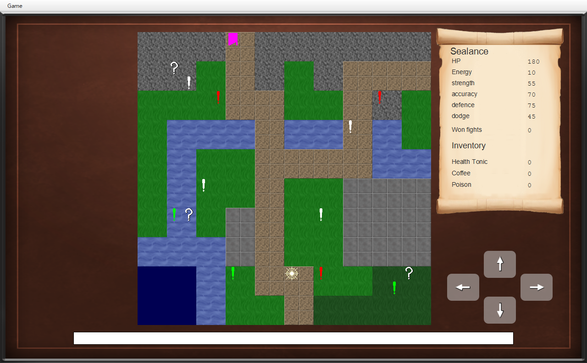
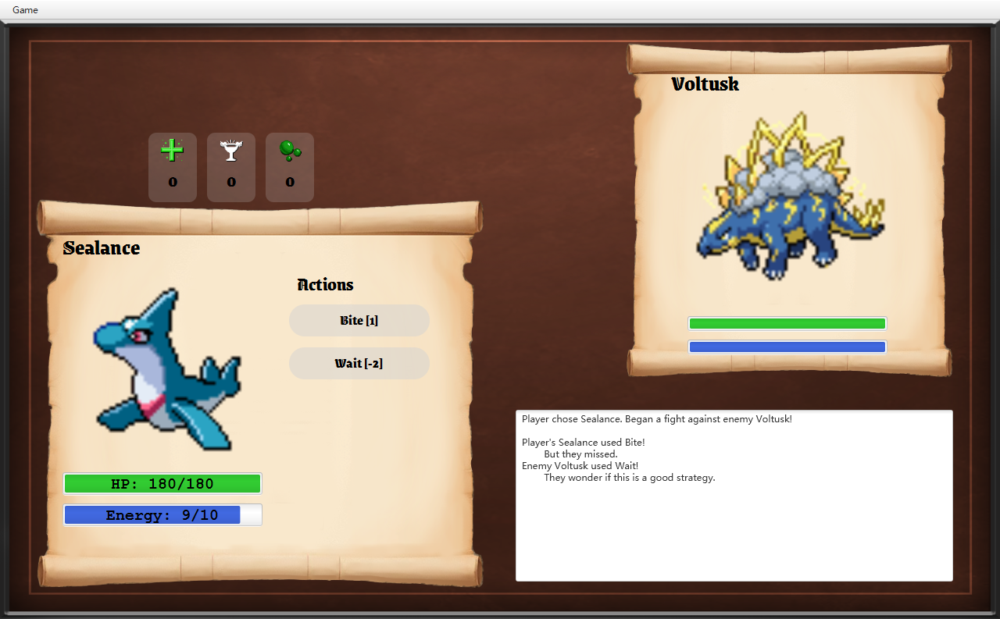

# Mokepon

Mokepon 是一款用 Java 和 JavaFX 开发的单人回合制冒险游戏。你可以从 36 只精灵中选一只，在 20 × 20 的地图上探索、拾取道具，最终抵达出口。遇敌时，地形会影响双方精灵的属性。你可以花费能量施放技能，也可以撤退，换一条路线。

| 地图探索 | 回合制战斗 |
| --- | --- |
|  |  |

## 运行游戏

安装 **JDK 25**，下载并解压仓库（或使用 Git 克隆），然后在包含 `mokepon.game` 和 `gradlew.bat` 的项目根目录打开终端。首次运行需要联网下载 Gradle 和 JavaFX 依赖。

**Windows · PowerShell**

```powershell
.\gradlew.bat run
```

**macOS / Linux · 终端**

```sh
sh ./gradlew run
```

**IntelliJ IDEA** 用户可以直接打开项目根目录，等待 Gradle 同步完成，再在 Gradle 面板中运行 `Tasks → application → run`。该任务会自动传入 `data=mokepon.game`。

## 怎么玩

1. **选精灵。** 点击名字查看属性和技能，再点击 **Choose Mokepon** 进入地图。
2. **探索地图。** 用方向键或屏幕上的箭头移动。踩到宝箱会自动拾取道具，进入遭遇点可以选择 **Fight!** 开战，或选择 **Run Away!** 退回上一格。
3. **进行战斗。** 点击技能按钮，或按数字键 `1`–`4` 选择对应技能。按钮上的方括号显示能量消耗。战斗日志会记录双方的行动和结果。
4. **抵达出口。** 战斗获胜后可以继续探索。到达出口时会显示本局获胜场数。

## 代码结构

| 想了解的功能 | 从这里看 |
| --- | --- |
| 回合如何结算 | [BattleEngine.java](src/main/java/au/edu/unimelb/swen/oop/mokepon/BattleEngine.java) 处理行动顺序、技能消耗检查、流血结算和胜负判定。战斗规则可以独立于 JavaFX 界面运行。 |
| 地图如何记录进度 | [GameSession.java](src/main/java/au/edu/unimelb/swen/oop/mokepon/GameSession.java) 管理位置、背包、剩余遭遇点和获胜场数。 |
| 界面如何切换 | [GameWindow.java](src/main/java/au/edu/unimelb/swen/oop/mokepon/GameWindow.java) 管理精灵选择、地图、战斗界面和弹窗。 |
| 精灵和地图如何配置 | [mokepon.game](mokepon.game) 定义精灵属性、技能组合、地图布局、遭遇点及道具位置。 |

<details>
<summary>游戏规则与实现约定</summary>

- 数据文件和图片的相对路径以程序的工作目录为基准。
- 再次点击已选中的精灵会保持当前选择。
- 强敌和弱敌遭遇点会按地形筛选对手。每个遭遇点应至少有一只符合条件的精灵。找不到时，程序会报告错误。
- 每次进入遭遇点都会重新抽取对手，包括逃跑后再次进入。同一候选列表中的每个条目被选中的概率相同。敌人也会从当前能量足以施放的技能条目中等概率选择。
- 眩晕和致盲按受影响精灵的行动次数计时。如果该精灵本回合已经行动，效果从它下次行动开始计数，并持续到第三次受影响行动所在回合的流血结算结束。
- 重复施加流血、眩晕或致盲会刷新持续时间。Lance 命中后，流血从当前回合末开始结算。伤害取决于攻击方当前力量、眩晕修正和目标当前防御。
- 宝箱与其他对象位于同一格时，先拾取宝箱。出口与遭遇点重合时，先处理遭遇，战斗获胜后再触发出口。
- 弹窗开启时，玩家需要点击弹窗按钮才能继续游戏或操作菜单，期间仍可关闭窗口。

</details>

## 课程来源与 AI 使用说明

本项目为墨尔本大学 SWEN20003（2026 年第二学期）Project 2，基于课程提供的 Project 1 初始代码、Project 2 材料和课堂讲义开发。

我使用 OpenAI ChatGPT 辅助理解项目要求和 Java、JavaFX 概念，生成和修改部分实现，对照要求检查程序，以及排查错误。我已自行审阅并理解最终实现。
